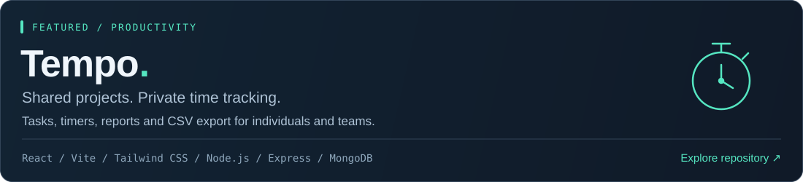

  

  <a href="#selected-work">Selected work</a> &nbsp; / &nbsp;
  <a href="#toolkit">Toolkit</a> &nbsp; / &nbsp;
  <a href="#behind-the-projects">Behind the projects</a> &nbsp; / &nbsp;
  <a href="https://github.com/Moataz-Manaa?tab=repositories">All repositories ↗</a>

<h2>Hi, I'm Moataz.</h2>

I build full-stack applications with <strong>Java, Spring Boot, Angular, React and Node.js</strong>. My projects connect practical workflows with clear interfaces, structured APIs and role-based access.

Explore the code below—from time tracking and team productivity to agricultural management and fitness applications.

<h2 id="selected-work">Selected work</h2>

<table width="100%">
  <tr>
    <td width="33%" valign="top">
      
      
<a href="https://github.com/Moataz-Manaa/smartAgri">Code ↗</a> · <a href="https://github.com/Moataz-Manaa/smartAgri#readme">Docs</a>

    </td>
    <td width="33%" valign="top">
      
      
<a href="https://github.com/Moataz-Manaa/fitConnect">Code ↗</a> · <a href="https://github.com/Moataz-Manaa/fitConnect/tree/master/frontend">Frontend</a> · <a href="https://github.com/Moataz-Manaa/fitConnect/tree/master/backend">Backend</a>

    </td>
    <td width="33%" valign="top">
      
      
<a href="https://github.com/Moataz-Manaa/time-tracking">Code ↗</a> · <a href="https://github.com/Moataz-Manaa/time-tracking#readme">Setup</a> · <a href="https://github.com/Moataz-Manaa/time-tracking/blob/main/docs/ARCHITECTURE.md">Architecture</a>

    </td>
  </tr>
</table>

<h2 id="toolkit">Toolkit</h2>

<code>React</code> · <code>JavaScript</code> · <code>Node.js</code> · <code>Express</code> · <code>MongoDB</code> · <code>Vite</code>

<table>
  <tr><td><strong>Interfaces</strong></td><td>Angular, React, TypeScript, JavaScript, Tailwind CSS, Vite</td></tr>
  <tr><td><strong>APIs &amp; data</strong></td><td>Java, Spring Boot, Node.js, Express, PostgreSQL, MySQL, MongoDB</td></tr>
  <tr><td><strong>Identity &amp; access</strong></td><td>Keycloak, session-based authentication, role-based application workflows</td></tr>
</table>

<h2 id="behind-the-projects">Behind the projects</h2>

Open a section to take a closer look.

  
<strong>01 / Inside SmartAgri</strong>

   
  
A management application for a company with multiple farms and plots. The repository brings together an Angular interface, a Spring Boot API, PostgreSQL data storage and Keycloak authentication.

  <ul>
    <li><strong>Domain:</strong> farms, plots, user profiles and assignments.</li>
    <li><strong>Structure:</strong> controllers, DTOs, services and repositories on the backend; feature-based organization on the frontend.</li>
    <li><strong>Explore:</strong> <a href="https://github.com/Moataz-Manaa/smartAgri#readme">architecture and project documentation</a>.</li>
  </ul>

  
<strong>02 / Inside FitConnect</strong>

   
  
A fitness project organized into separate frontend, backend and admin applications. It combines Angular with Spring Boot and MySQL.

  <ul>
    <li><strong>Interface:</strong> Angular with calendar and charting dependencies.</li>
    <li><strong>API:</strong> Java and Spring Boot with JPA, mail and WebSocket dependencies.</li>
    <li><strong>Explore:</strong> <a href="https://github.com/Moataz-Manaa/fitConnect/tree/master/admin">admin application</a> and <a href="https://github.com/Moataz-Manaa/fitConnect/tree/master/backend">backend source</a>.</li>
  </ul>

  
<strong>03 / Inside Tempo</strong>

   
  
A time tracker for individuals and teams, built with React, Vite, Tailwind CSS, Express and MongoDB. Projects and tasks can be shared with teammates while each account keeps its time entries, running timer and reports private.

  <ul>
    <li><strong>Team workflows:</strong> project membership, task assignments, priorities, due dates and combined filters.</li>
    <li><strong>Time tracking:</strong> one running timer per account, timer restoration after refresh, and manual entry creation and editing.</li>
    <li><strong>Reports:</strong> date-range totals and breakdowns by project or task, with CSV export.</li>
    <li><strong>Explore:</strong> <a href="https://github.com/Moataz-Manaa/time-tracking#quick-start">local setup</a>, <a href="https://github.com/Moataz-Manaa/time-tracking/blob/main/docs/ARCHITECTURE.md">architecture</a> and <a href="https://github.com/Moataz-Manaa/time-tracking#api">API documentation</a>.</li>
  </ul>

 

<strong>Thanks for exploring my work.</strong> <a href="https://github.com/Moataz-Manaa?tab=repositories">Browse the repositories ↗</a> &nbsp; · &nbsp; <a href="#">Back to top ↑</a>

